# IoT challenges: ESP32 energy, CoAP/MQTT traffic, Node-RED and LoRaWAN

Three lab challenges and a homework for *Internet of Things* at Politecnico di Milano (2025, course grade 30/30). Own work. Each folder has the submitted report next to the scripts and data it used.

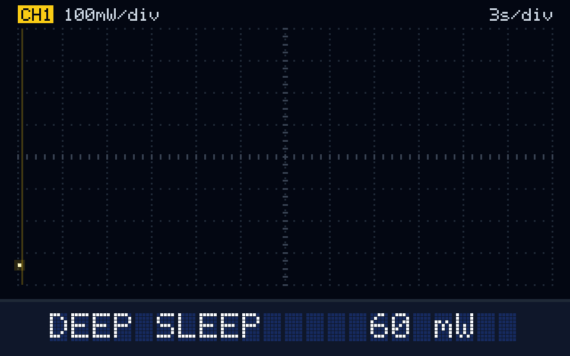

*The parking sensor's power draw over two wake-ups, drawn from the supplied `deep_sleep.csv` (20 Hz). State names as in the report.*

## 1. Battery life of an ESP32 parking sensor

[`challenge1-esp32-energy/`](challenge1-esp32-energy)

An ESP32 emulated in Wokwi reads an HC-SR04 ultrasonic sensor, decides FREE/OCCUPIED (≤ 50 cm), sends it to a sink node over ESP-NOW and goes straight back to deep sleep for 25 s. The sketch is explained in [`report.pdf`](challenge1-esp32-energy/report.pdf).

- `energy_analysis.m` takes the mean power of each state from the course-supplied power traces (`data/*.csv`): deep sleep 59.6 mW, boot 371 mW, idle 332 mW, measuring 467 mW, Wi-Fi on 704 mW, transmitting at 19.5 dBm 1222 mW.
- Combined with the state durations timed in the emulation, one cycle is 25.298 s and 1.668 J, so an 18,520 J battery lasts **78.0 hours**.
- The boot time (about 80 ms) is not visible in emulation, so it was read off the trace. Booting turns out to be the second-largest active cost after Wi-Fi.

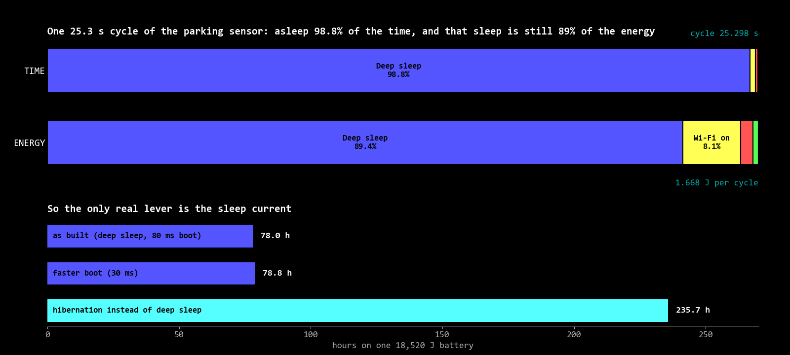

The node is asleep for 98.8% of the cycle, and that sleep still costs 89% of the energy, so shaving the active phase barely matters (a 30 ms boot only gives 78.8 h). Switching from deep sleep to hibernation, at roughly a quarter of the sleep power, takes it to **235.7 hours**.

**Where to put the sink** ([`sink_position.pdf`](challenge1-esp32-energy/sink_position.pdf)). Ten sensors, transmit energy growing with distance squared, and the network lifetime ends when the first battery dies. With the sink at the given (20, 20), the farthest sensor dies after 34 minutes. Minimising the worst-case distance (`fminimax`) puts the sink at (6.9, 7.7), giving 214.6 minutes.

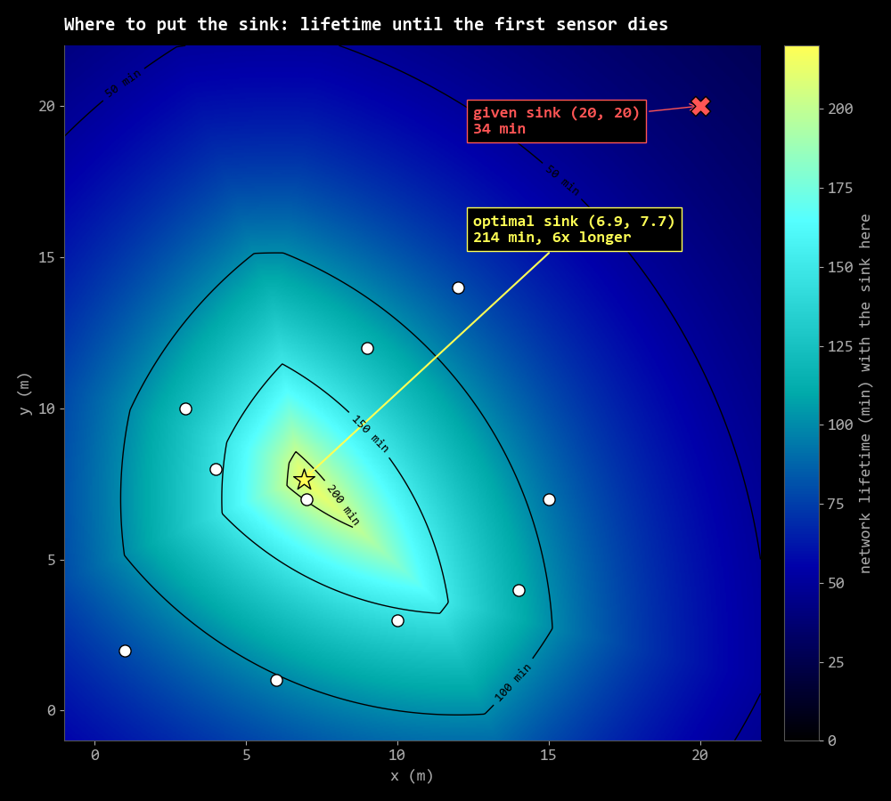

## 2. Reading CoAP and MQTT traffic from a capture

[`challenge2-coap-mqtt/`](challenge2-coap-mqtt)

Seven questions on a 12.7 MB Wireshark capture (`challenge2.pcapng`), answered with display filters and `pyshark` scripts that correlate requests and responses by message ID and token:

| Question | Answer |
|---|---|
| Confirmable PUTs to the local CoAP server that got an error or RST | 22 |
| coap.me resources with equal numbers of CON and NON GETs | 3 |
| MQTT clients subscribing to HiveMQ with a multi-level wildcard | 4 |
| Clients whose last will goes to a `university/...` topic | 1 |
| Subscribers that receive a last will through a non-wildcard subscription | 3 |
| Retained QoS 0 publishes to the mosquitto broker | 208 |
| MQTT-SN messages to the local broker on port 1885 | 0 |

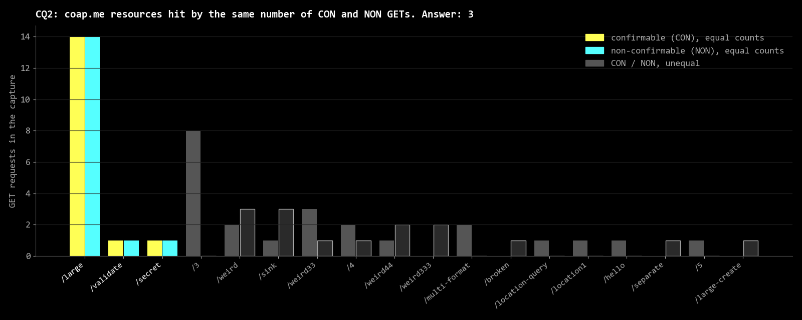

`energy_coap_vs_mqtt.py` compares a day of a battery sensor and valve talking over CoAP observe or MQTT QoS 0 (sensor 6.39 mJ vs 7.88 mJ per day), then cuts the valve's share by moving the averaging onto the always-powered Raspberry Pi broker.

## 3. Node-RED, ThingSpeak and LoRaWAN capacity

[`challenge3-node-red-lorawan/`](challenge3-node-red-lorawan)

**Node-RED flow** (`node-red-flow.json`): generates random IDs every 5 s and publishes them over MQTT; for each received ID it looks up row `id % 7711` of the challenge CSV and replays that publish (rate-limited to 4 per minute), filters the Fahrenheit temperature readings onto a dashboard chart and a log file, and counts ACKs into a ThingSpeak channel. Processing stops after 80 messages. The ThingSpeak write key has been replaced with a placeholder.

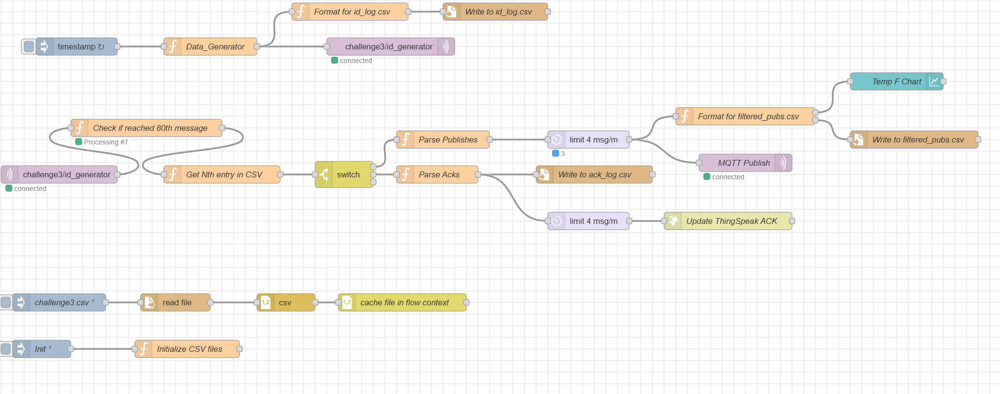

| Filtered temperature (dashboard) | ACK counter (ThingSpeak) |
|---|---|
| 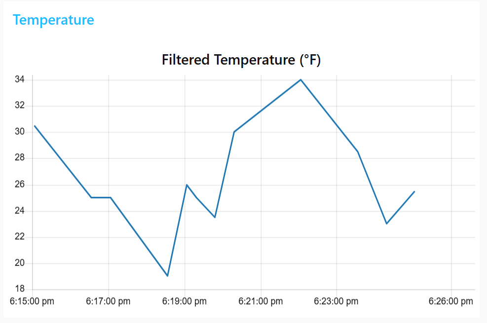 | 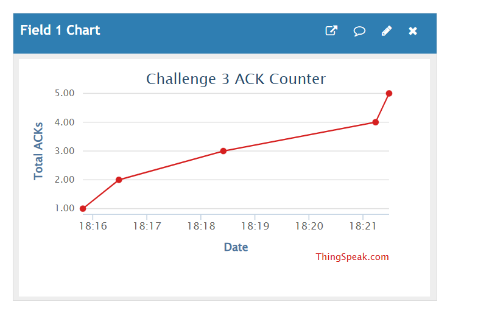 |

**Largest spreading factor for 50 nodes** (`lorawan_max_sf.py`). One gateway, 50 nodes each sending one packet a minute, modelled as pure ALOHA (success = e^(-2G)) with airtimes from the TTN calculator. SF8 is the slowest that still delivers at least 70%.

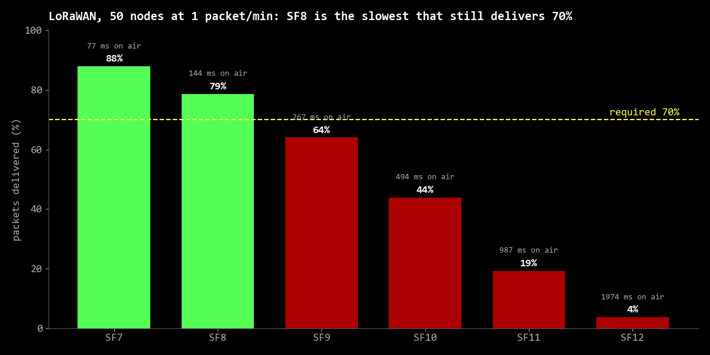

**Reproducing Bor et al., "Do LoRa Low-Power Wide-Area Networks Scale?"** (`lorasim_reproduction.ipynb`). Figures 5 and 7 of the paper rerun with LoRaSim: data extraction rate against network size for static and dynamic radio settings, and for 1 to 24 sinks.

| Figure 5: radio settings, one sink | Figure 7: more sinks |
|---|---|
| 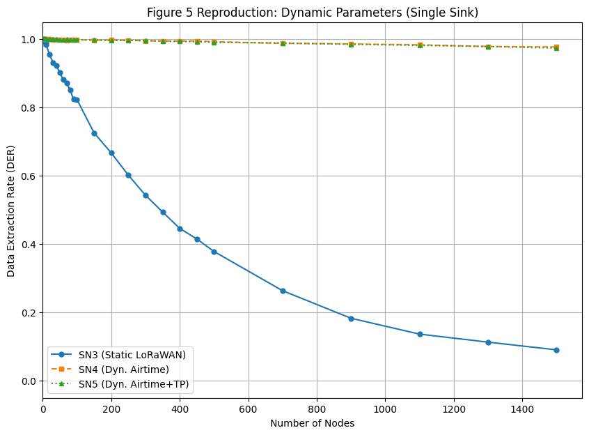 | 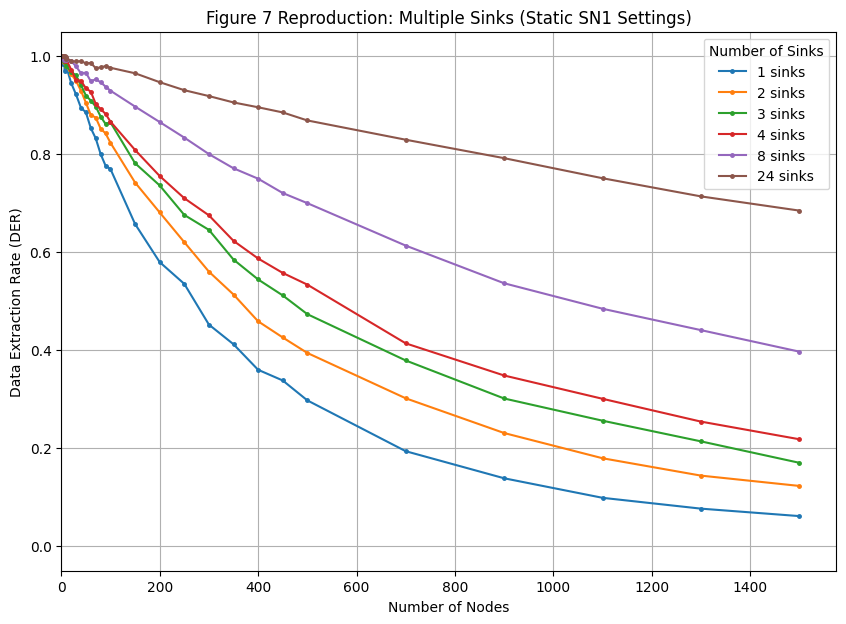 |

## Homework: RFID collision resolution

[`homework-rfid/`](homework-rfid): exact resolution times and efficiency for 4 tags with initial frame sizes 1 to 6, using exact fractions. Efficiency peaks at 0.453 when the frame size matches the number of tags.

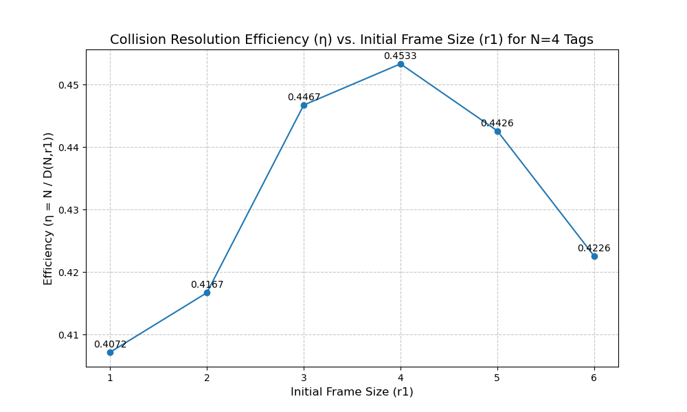

## Running it

- `challenge1-esp32-energy/energy_analysis.m`: MATLAB, run from its folder (reads `data/`).
- `challenge2-coap-mqtt/*.py`: Python with `pyshark` and Wireshark/tshark installed; run next to `challenge2.pcapng`.
- `challenge3-node-red-lorawan/node-red-flow.json`: import into Node-RED; it expects an MQTT broker on `localhost:1884` and `challenge3.csv`.
- `lorasim/` is LoRaSim by Thiemo Voigt and Martin Bor (CC BY 4.0), included with the directional and multi-sink variants used by the notebook. It runs on Python 2 (see `lorasim/requirements.txt`).

Figures in `docs/` other than the report screenshots were drawn from the numbers and files in this repo.
